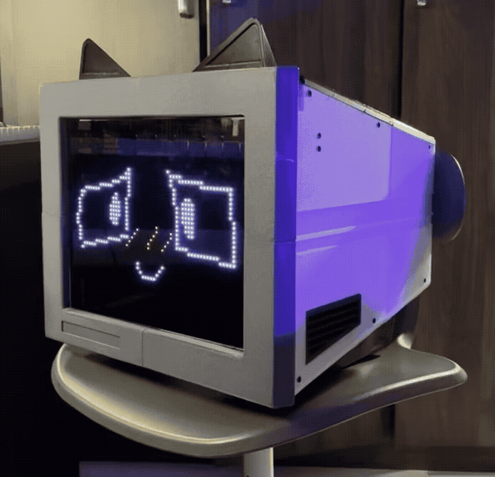
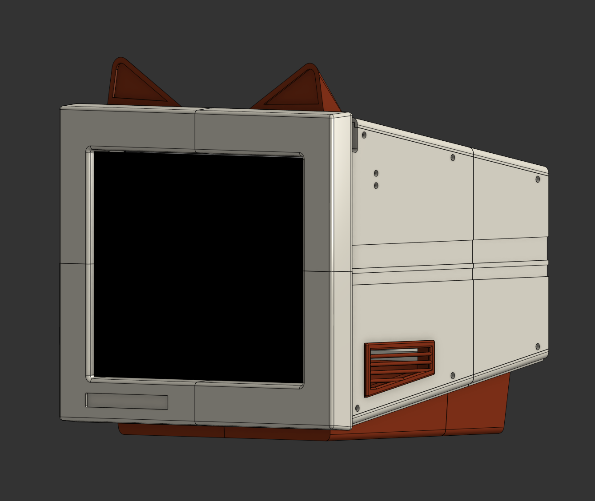
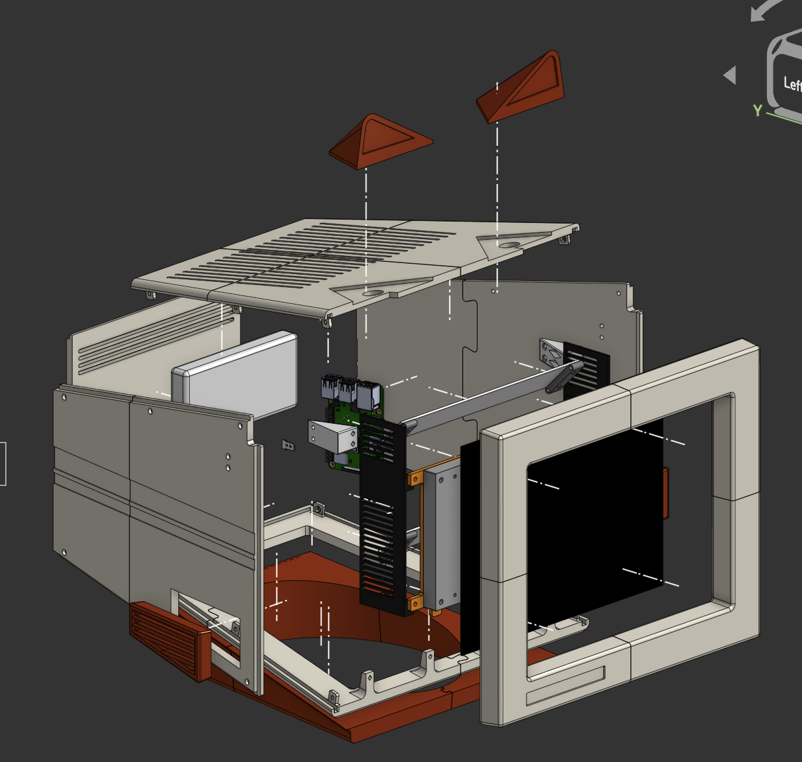
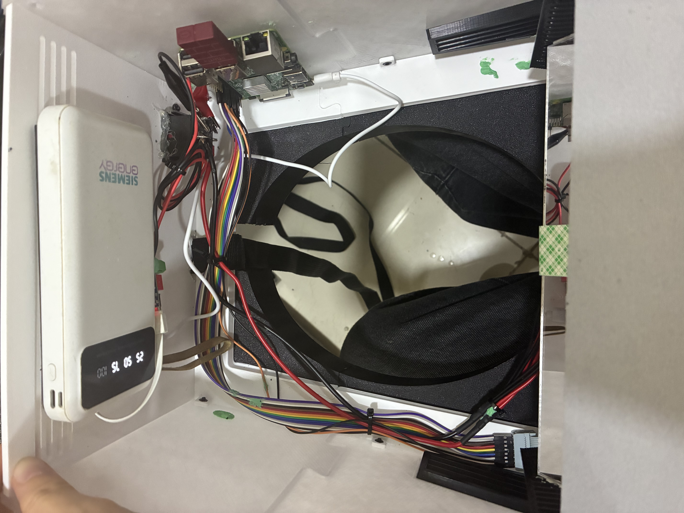

# MICO

A 3d printed, lightweight TV head, with periscopes for viewing, powered by HUB75 and Raspi!
The name MICO comes from Fa**MICO**m, the original inspiration for the project's exterior design

Saw some projects like [2swap](https://github.com/autowattage/2swap) and [Minbitt's TV Head](https://www.youtube.com/watch?v=yEIA7uc1x5s) and was inspired to make my own... not knowing it would take three months of work and agony, and a missed convention

I learnt a LOT of Onshape (basically had to start from zero knowledge, you can see going down the line when i've learned a useful skill and left all the previous jank behind lol), plus I learnt how to use git, vscode, learnt how to solder a BMS, like literally everything (can you tell this is my first project......)

I designed this as a project for Hack Club's [Stardance!](https://stardance.hackclub.com/)

-------------------
----
### [View the demo video! <----------------------- hello is this unmissable enough](https://eunalian.github.io/tvhead.html)
---
---

## CAD
Everything is fitted using M3 screws, nuts, heat set inserts, and too much blue tack. (magnets, as well as the bottom wedge and side grills are glued.) Wires are arranged around the perimiter of the inside space. A guide for wiring the HUB75 panel can be found [here](https://github.com/chrisgilldc/rpi-rgb-led-matrix-pybuild/blob/master/wiring.md).

[View in Onshape :3](https://cad.onshape.com/documents/f897ad7f1a3873b71de9b8c0/w/de1a01354596991039c58223/e/3f06bed91d87894ab371f5e0?renderMode=0&uiState=6ae22b3c28991499d052626f)

## Features:
* Mounted periscope to view out of
* HUB75 screen
* Powerbank + USB C 303PdSink module for power
* Macropad controlled animation switching (uses RPI 3B+ with USB Keyboard)
* RPi 3b+ 
* magnetic cat ears? :3

## How it works:
firmware.py accepts multiple file paths to gifs in its arguments. If no arguments are provided, gifs in [face-art](./face-art) are loaded instead. The PIL library processes each gif, returning a list of gif frames. This list is defined as an attribue of a gif object, namely `gif.frames`. The `rpi-rgb-led-matrix-pybuild` library then loads these frames as canvas buffers to display on the HUB75 screen. `evdev` is used to read keyboard inputs.

## How to use it:
After aseembly, SSH into the rpi then follow the [installation guide](firmware/README.md). Once the python script is running, press F1-F12 to switch between gifs.

## Special thanks:
* [@hzeller](https://github.com/hzeller) for his [rpi-rgb-led-matrix](https://github.com/hzeller/rpi-rgb-led-matrix) library!
* [@chrisgilldc](https://github.com/chrisgilldc) for his [fork](https://github.com/chrisgilldc/rpi-rgb-led-matrix-pybuild) that fixes the broken rpi-rgb-led-matrix library python binding....