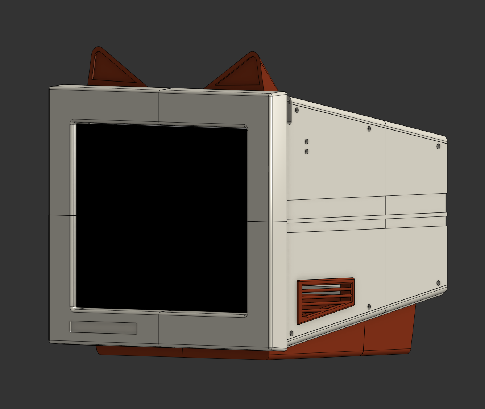
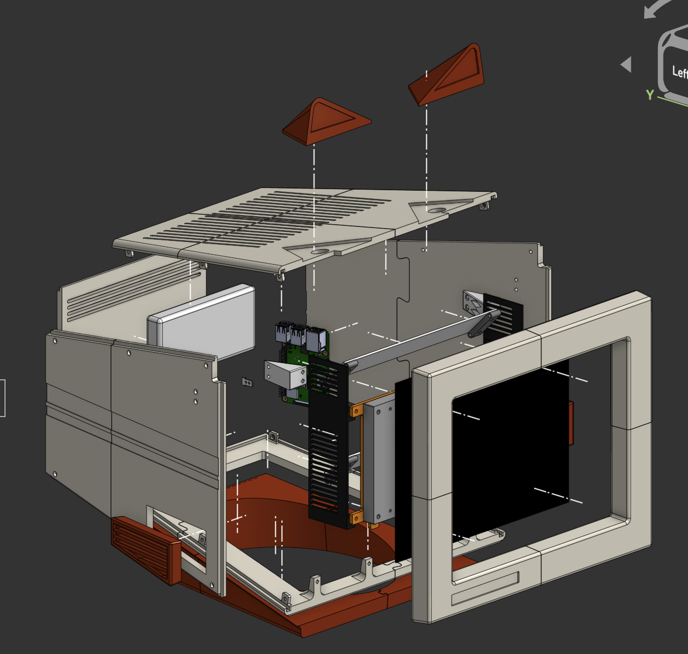

# MICO

A 3d printed, lightweight TV head, with periscopes for viewing, powered by HUB75 and Raspi!
The name MICO comes from Fa**MICO**m, the original inspiration for the project's exterior design

![]

Saw some projects like [2swap](https://github.com/autowattage/2swap) and [Minbitt's TV Head](https://www.youtube.com/watch?v=yEIA7uc1x5s) and was inspired to make my own... not knowing it would take three months of work and agony, and a missed convention

I learnt a LOT of Onshape (basically had to start from zero knowledge, you can see going down the line when i've learned a useful skill and left all the previous jank behind lol), plus I learnt how to use git, vscode, learnt how to solder a BMS, like literally everything (can you tell this is my first project......)

I designed this as a project for Hack Club's [Stardance!](https://stardance.hackclub.com/)

## CAD

[View in Onshape :3](https://cad.onshape.com/documents/f897ad7f1a3873b71de9b8c0/w/de1a01354596991039c58223/e/3f06bed91d87894ab371f5e0?renderMode=0&uiState=6ae22b3c28991499d052626f)

## Features:
* Mounted periscope to view out of
* HUB75 screen
* Powerbank + USB C 303PdSink module for power
* Macropad controlled animation switching (uses RPI 3B+ with USB Keyboard)
* RPi 3b+ 
* magnetic cat ears?

## To Do:
* ~~solder switch and bms and connect to RPI + Hub75 screen~~
* ~~cut bicycle helmet for comfortable wearing (comfort is optional)~~
* ~~edit colors in onshape back to intended colors~~
* ~~make install.sh script in root folder for convenient installing into rpi~~ (i dont really know how to do this properly)
* add photos in readme.md (ill probably need to finish to take photos)
* write assembly guide
* make wiring diagram
* draw extra face animations!!!
* make demo video!!