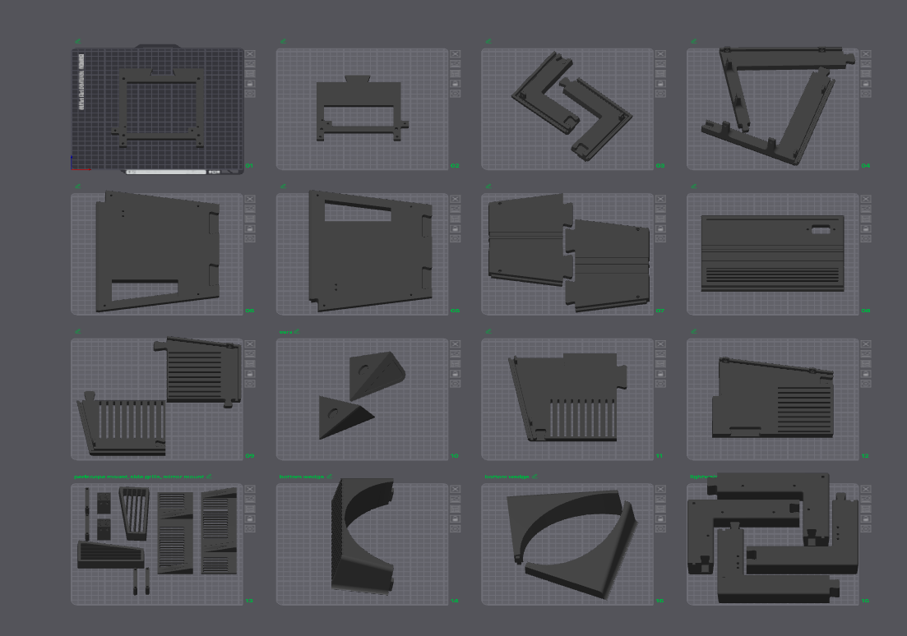
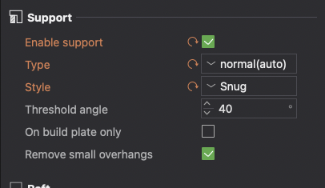
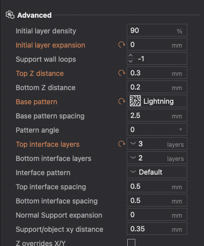

# Guide for printing:

Most of the time, you can get away with 2-3% infill. Honeycomb pattern recommended, as gyroid infill can suffer from large internal overhangs.

If you are spray painting, you **must have at least 4 side/top/bottom walls.** This is to prevent exposing the sparse infill when sanding.

All .stls are oriented in their recommended print orientation. Support settings are recommended to be set as the following:

Even more ideal would be to use PLA/PETG support interfaces.

A generic .3mf file can be found at STLs/MICO.3mf, as well as a generic .step file.

### Encountered issues:
* Sometimes, M3 Nuts may not fit in their respective slots. 
* Removing supports from through holes may be difficult.
* The front bezel pilot holes for heat set inserts may not print properly, if infill percentage is set too low.
* The front bezel is too heavy.

happy printing :3 **The total measured filament usage is 1268.66 g**